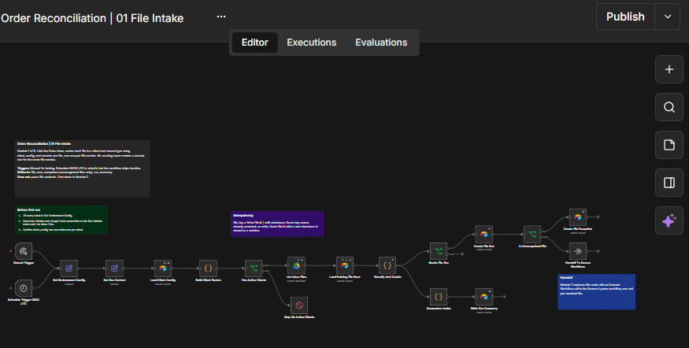
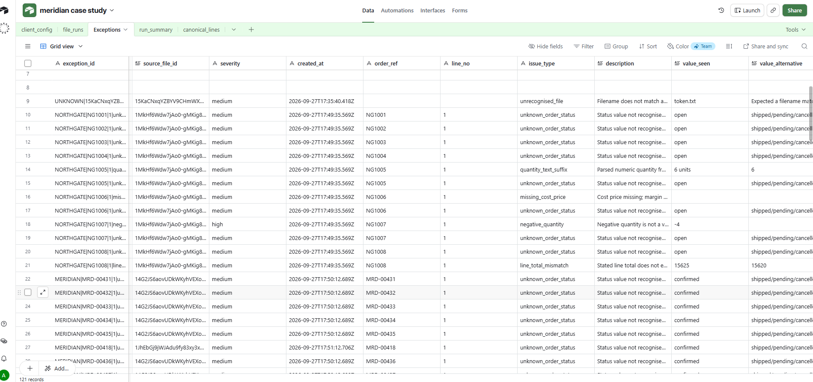
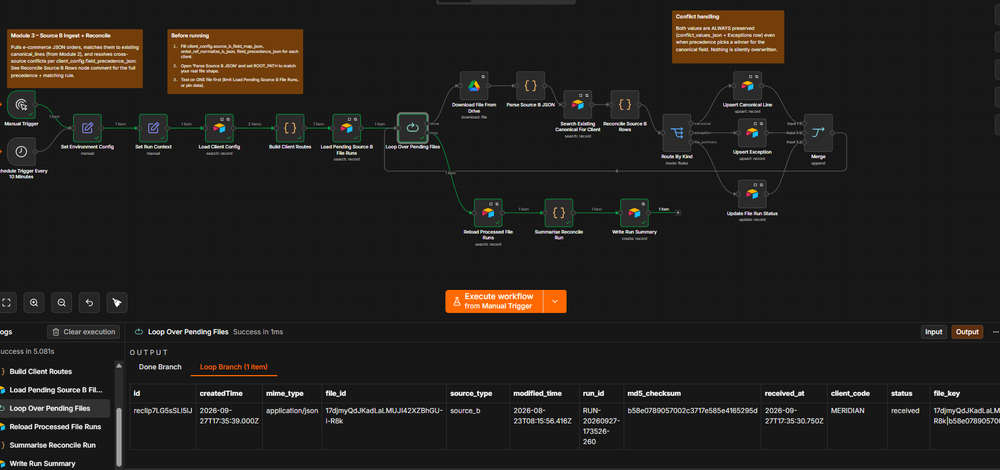

# Meridian Order Reconciliation

A set of n8n workflows for reconciling Meridian order data across file intake, Source A cleanup, and Source B ingestion. The workflows use Google Drive for inbound files and Airtable for configuration, staging, exceptions, and reconciliation records.

The assessment write-up, including completed work, limitations, and next steps, is in [case-study.md](case-study.md).

## Workflows

| File | Purpose |
| --- | --- |
| [01 File Intake](workflows/01-file-intake.json) | Finds inbound files, records file runs, and routes files to processing. |
| [02 Source A Parse and Clean](workflows/02-source-a-parse-and-clean.json) | Parses Source A order rows, normalizes fields, and records validation exceptions. |
| [03 Reconcile Source B](workflows/03-reconcile-source-b.json) | Ingests Source B orders and reconciles them against canonical lines. |

These are workflow exports, not a turnkey deployment. Import them into n8n, select your own Google Drive and Airtable credentials, and configure the environment values and Airtable schema before running. Credential bindings have been removed from the published copies.

## Screenshots

### File intake workflow

### Airtable exception records

### Source B reconciliation run

